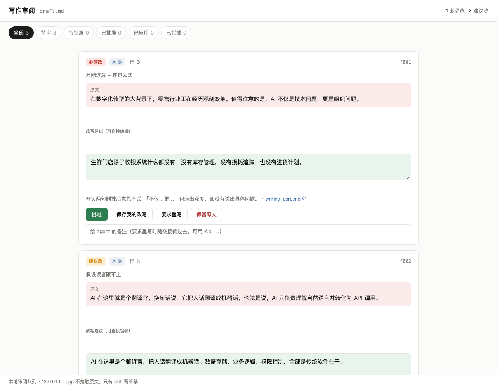

# remove-ai-taste

[中文](README.md)

Review or rewrite Chinese and English prose to strip out AI writing habits. Numbers, dates, names, quotes and URLs come through untouched, and so do the author's arguments and voice.

It runs as a Claude Code or Codex skill: one skill file, a scanner, a local review UI and two checking scripts. A long draft goes from diagnosis to saved file like this:

1. **Scan.** `scripts/scan_ai_taste.py` does a first pass tuned to the genre. It skips code blocks, links and quotes, and only reports a pattern when it clusters.
2. **Diagnose.** The agent checks each hit against `references/writing-core.md`, adds the logic and structure problems a scanner can't see, and writes the original line next to a proposed rewrite.
3. **Batch.** `scripts/write_batch.mjs` packs the findings into one review batch.
4. **Author decides.** `bash app/start.sh` opens a page on 127.0.0.1. For each finding the author approves, edits the rewrite, sends it back for another try, or keeps the original. Items sent back return to the agent and come round again.
5. **Apply.** `scripts/apply_decisions.mjs` writes approved edits into the draft by matching the original text, not line numbers. If the author changed a passage while deciding, that item is reported as stale instead of being overwritten.
6. **Verify.** `scripts/verify_preservation.py` diffs before and after and fails if a number, name or quote changed.

For a handful of findings, or on a machine without a screen, skip steps 3–5: the agent puts the review or the rewritten text straight into the conversation.



## Example: a weekly project report to a client

The draft is a made-up weekly report on a customer-service AI project, written for Mr. Wang, the client's head of customer service. It is in Chinese, as is the output of `workflows/remove-ai-taste.js` below, run with `readerCuts` on so the reader rules may remove content.

<details>
<summary>Original (click to expand)</summary>

```markdown
# 智能客服项目第 6 周进展汇报

**汇报对象：** 客户服务中心王总
**汇报人：** 项目组

## 一、项目概述

在数字化转型的大背景下，客户服务正在经历一场深刻的变革。值得注意的是，智能客服不仅是一次技术升级，更是一次服务理念的全面重塑。本项目旨在通过 AI 赋能一线客服团队，打通数据壁垒，实现降本增效的目标。

## 二、本周核心成果

本周，项目组围绕"提质、增效、降本"三大核心目标，扎实推进各项工作，取得了显著成效：

- **效率提升：** 本周智能客服共处理工单 1,240 张，自动解决率从上周的 38% 提升至 52%，实现了质的飞跃。
- **体验优化：** 平均首次响应时间从 4.2 小时缩短至 35 分钟，客户满意度得到显著提升。
- **成本节约：** 按当前解决率测算，每月可节省约 3 名客服人员的工作量，为企业创造了可观的价值。

## 三、关键里程碑与排期

| 任务 | 负责人 | 计划完成 |
|------|--------|----------|
| 退款类意图训练 | 小李 | 第 7 周周三 |
| 知识库第二批导入 | 小张 | 第 7 周周五 |
| 坐席端插件联调 | 小陈、小刘 | 第 8 周周二 |
| 第二期款项开票 | 商务 | 第 8 周 |

## 四、存在的问题与挑战

当然，我们也要清醒地看到，项目推进过程中仍面临一些挑战。换句话说，机遇与挑战并存。具体而言，退款类问题的自动解决率仍然只有 11%，主要原因是退款规则分散在 4 个系统里，AI 无法获得完整信息。也就是说，数据孤岛问题依然是制约项目进一步发展的关键瓶颈。

## 五、下一步计划

接下来，项目组将继续秉持"以客户为中心"的理念，持续深化 AI 能力建设，全面提升服务质量，为客户服务中心的高质量发展注入新动能。

## 六、总结

总而言之，第 6 周项目进展顺利，成果显著。我们相信，在王总的大力支持下，智能客服项目必将取得更大的成功，助力企业在激烈的市场竞争中赢得先机！
```

</details>

Rewritten:

```markdown
# 智能客服项目第 6 周进展汇报

汇报对象：客户服务中心王总
汇报人：项目组

## 本周数字

本周智能客服处理工单 1,240 张，自动解决率从上周的 38% 升到 52%，提高 14 个百分点。平均首次响应时间从 4.2 小时缩到 35 分钟。按当前解决率测算，每月可省下约 3 名客服的工作量。

## 退款类自动解决率 11%

退款类问题的自动解决率还只有 11%。退款规则分散在 4 个系统里，AI 拿不到完整的规则。

## 后续排期

| 任务 | 计划完成 |
|------|----------|
| 退款类意图训练 | 第 7 周周三 |
| 知识库第二批导入 | 第 7 周周五 |
| 坐席端插件联调 | 第 8 周周二 |
```

What changed:

- The opening on "digital transformation", the "not only… but also…" line and the jargon ("empower", "break down data silos", "cut cost, raise efficiency") are gone. In week 6 the client does not need the project's background.
- "A qualitative leap", "significantly improved" and "considerable value" became the numbers the draft already had: 38% to 52%, up 14 points.
- Filler transitions ("in other words", "that is to say", "opportunities and challenges coexist") are cut, and the refund problem is stated once.
- Bold-label bullets became one paragraph. Six template sections became three, with headings that state the content, e.g. "Refund auto-resolution: 11%".
- Rule 9 removed the owner column and the "invoice second payment" row. Who does the work and when the vendor bills are not decisions this reader makes.
- "Next steps" and "Summary" held only slogans and were deleted. The workflow did not invent a plan; it reported the gap to the author. "Customer satisfaction improved significantly" had no number and went too.

Every number, date and count is unchanged. The scanner flagged 4 spots in the original and none in the rewrite.

## Install

Claude Code:

```bash
git clone https://github.com/Agents-Zone/remove-ai-taste.git ~/.claude/skills/remove-ai-taste
```

Codex (same directory; `agents/openai.yaml` supplies the display name and default prompt):

```bash
git clone https://github.com/Agents-Zone/remove-ai-taste.git ~/.codex/skills/remove-ai-taste
```

If you use both, clone once and symlink the other path.

Needs Python 3 and Node. Both use only the standard library, so there is nothing to install.

## Usage

In Claude Code:

```
/remove-ai-taste draft.md                 # review: report only, draft untouched
remove the AI taste from draft.md         # rewrite in place
/remove-ai-taste 123                      # review the .md changes in PR #123
```

Scripts on their own:

```bash
python3 scripts/scan_ai_taste.py draft.md --profile article     # article / professional / marketing / translation / short-message
python3 scripts/verify_preservation.py original.md revised.md
python3 -m unittest discover -s tests -q
```

## Multi-agent workflow

`workflows/remove-ai-taste.js` is a Claude Code Workflow script that hands one draft to a team of agents:

1. One agent runs the scanner.
2. Four agents diagnose in parallel, one lens each: AI habits, structure and density, the reader (rules 8–9), facts and terms.
3. Findings on the same line go to one skeptic whose job is to refute the weak ones. In the example above it rejected 21 of 39.
4. One agent rewrites at paragraph level into a new file; the original stays as is.
5. Two agents check at once: one for changed facts, changed claims or anything invented, one for remaining AI habits. A failed check gets one repair round.

Run it from Claude Code by asking:

```
run the workflow ~/.claude/skills/remove-ai-taste/workflows/remove-ai-taste.js
with args {"draft": "/abs/path/draft.md", "profile": "professional"}
```

| Arg | Meaning |
|-----|---------|
| `draft` | absolute path to the draft, required |
| `mode` | `rewrite` (default) or `review` (report only) |
| `out` | output path; defaults to `.revised.md` or `.review.md` next to the draft |
| `profile` | scanner profile, as above |
| `readerCuts` | `true` lets rules 8–9 delete content; by default cuts are only listed for the author |
| `skillDir` | set if the skill is not at `~/.claude/skills/remove-ai-taste` |

It costs far more than calling the skill. The 40-line report above took about 27 agents and roughly a million tokens. Use the skill for short pieces and everyday edits, and the workflow for client deliverables or anything you publish. Workflow is a Claude Code feature and does not run in Codex.

## Rules

`references/rules.md` has nine rules, written in Chinese. Copy them into your `CLAUDE.md` or `AGENTS.md` so every session carries them.

Rules 1–7 cover AI habits: edit style only unless asked; no structure made of colons and bold labels; no "not X but Y" framing; cut filler transitions; let information weight set the structure; prefer nouns, actions and numbers over praise words; make people or things the subject. `references/writing-core.md` expands each one with tests and before/after examples. For English drafts the agent also reads `references/anti-ai-fingerprints.md`.

Rules 8–9 are about the reader. Before writing, decide who reads it and what they have to decide. Leave out details for decisions that reader doesn't make. In a review these two get their own section.

Genre conventions, such as which claims need a source or whether a closing slogan is fine, belong in each project's own `AGENTS.md` or style guide, and the skill reads them from there. Conventions for review comments and recommendations are in `references/genre-review.md`.

The design of the UI and the handoff files is in `APP-IN-SKILL-DESIGN.md`.

## License

MIT
