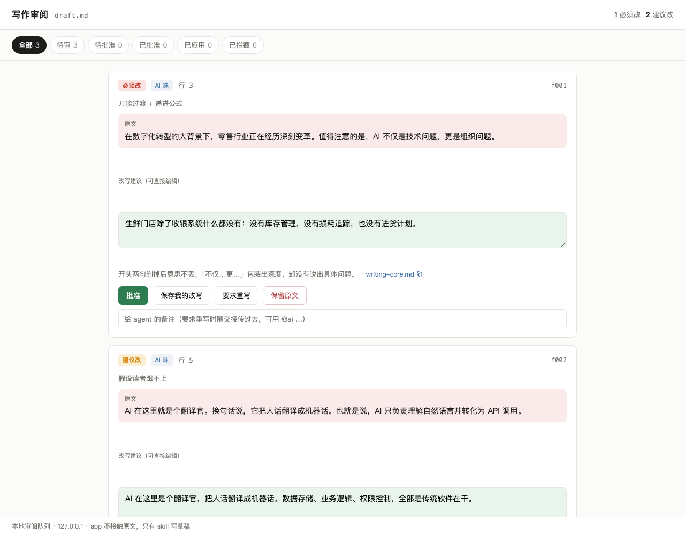

# remove-ai-taste

[English](README.en.md)

审阅或改写中英文文字，去掉 AI 腔。数字、日期、专名、引文、URL 原样保留，作者的观点和声音不动。

它以 Claude Code / Codex skill 的形式运行，由一个 skill、一个扫描器、一个本地审阅界面和两个校验脚本组成。一篇长文从诊断到落盘走下面这条流程：

1. **扫描**。`scripts/scan_ai_taste.py` 按文体档位初筛，跳过代码块、链接、引文，同类问题成簇出现才报。
2. **诊断**。Claude 按 `references/writing-core.md` 的判定标准复核扫描结果，补上扫描器抓不到的逻辑和结构问题，每条给出原文和改写。
3. **成批**。`scripts/write_batch.mjs` 把诊断结果写成一个审阅批次。
4. **作者裁决**。`bash app/start.sh` 在 127.0.0.1 开一个界面，作者逐条批准、改写、打回重写或保留原文。打回的条目回到 Claude 重写后再审。
5. **应用**。`scripts/apply_decisions.mjs` 按原文文本匹配，把批准的改动写回草稿。草稿在裁决期间被改过的条目会报出来，不强行覆盖。
6. **核对**。`scripts/verify_preservation.py` 对比改前改后，确认数字、专名、引文没有被改动。

条目少，或者没有显示器，就跳过第 3 到第 5 步，Claude 直接在对话里给审阅报告或改好的全文。



## 例子：一份给客户的项目周报

原稿是一份虚构的智能客服项目周报，写给客户方的王总。下面是用 `workflows/remove-ai-taste.js` 处理后的结果，跑的时候开了 `readerCuts`，允许按读者规则删内容。

<details>
<summary>原稿（点开看全文）</summary>

```markdown
# 智能客服项目第 6 周进展汇报

**汇报对象：** 客户服务中心王总
**汇报人：** 项目组

## 一、项目概述

在数字化转型的大背景下，客户服务正在经历一场深刻的变革。值得注意的是，智能客服不仅是一次技术升级，更是一次服务理念的全面重塑。本项目旨在通过 AI 赋能一线客服团队，打通数据壁垒，实现降本增效的目标。

## 二、本周核心成果

本周，项目组围绕"提质、增效、降本"三大核心目标，扎实推进各项工作，取得了显著成效：

- **效率提升：** 本周智能客服共处理工单 1,240 张，自动解决率从上周的 38% 提升至 52%，实现了质的飞跃。
- **体验优化：** 平均首次响应时间从 4.2 小时缩短至 35 分钟，客户满意度得到显著提升。
- **成本节约：** 按当前解决率测算，每月可节省约 3 名客服人员的工作量，为企业创造了可观的价值。

## 三、关键里程碑与排期

| 任务 | 负责人 | 计划完成 |
|------|--------|----------|
| 退款类意图训练 | 小李 | 第 7 周周三 |
| 知识库第二批导入 | 小张 | 第 7 周周五 |
| 坐席端插件联调 | 小陈、小刘 | 第 8 周周二 |
| 第二期款项开票 | 商务 | 第 8 周 |

## 四、存在的问题与挑战

当然，我们也要清醒地看到，项目推进过程中仍面临一些挑战。换句话说，机遇与挑战并存。具体而言，退款类问题的自动解决率仍然只有 11%，主要原因是退款规则分散在 4 个系统里，AI 无法获得完整信息。也就是说，数据孤岛问题依然是制约项目进一步发展的关键瓶颈。

## 五、下一步计划

接下来，项目组将继续秉持"以客户为中心"的理念，持续深化 AI 能力建设，全面提升服务质量，为客户服务中心的高质量发展注入新动能。

## 六、总结

总而言之，第 6 周项目进展顺利，成果显著。我们相信，在王总的大力支持下，智能客服项目必将取得更大的成功，助力企业在激烈的市场竞争中赢得先机！
```

</details>

改写后：

```markdown
# 智能客服项目第 6 周进展汇报

汇报对象：客户服务中心王总
汇报人：项目组

## 本周数字

本周智能客服处理工单 1,240 张，自动解决率从上周的 38% 升到 52%，提高 14 个百分点。平均首次响应时间从 4.2 小时缩到 35 分钟。按当前解决率测算，每月可省下约 3 名客服的工作量。

## 退款类自动解决率 11%

退款类问题的自动解决率还只有 11%。退款规则分散在 4 个系统里，AI 拿不到完整的规则。

## 后续排期

| 任务 | 计划完成 |
|------|----------|
| 退款类意图训练 | 第 7 周周三 |
| 知识库第二批导入 | 第 7 周周五 |
| 坐席端插件联调 | 第 8 周周二 |
```

改了这些地方：

- 「数字化转型的大背景下」「不仅是…更是…」「赋能」「打通数据壁垒」「降本增效」整段删掉。王总在第 6 周不需要有人给他讲项目背景。
- 「质的飞跃」「显著提升」「可观的价值」换成原稿里已有的数字：38% 升到 52%，提高 14 个百分点。
- 「换句话说」「也就是说」「机遇与挑战并存」这类结构话删掉，退款问题只说一遍。
- 加粗标签加冒号的列表改成一段话，六段模板标题改成三段，标题直接写内容，比如「退款类自动解决率 11%」。
- 按第 9 条删掉负责人一列和「第二期款项开票」一行：谁来做、什么时候开票，都不是王总要拍板的事。
- 「下一步计划」和「总结」只有口号，删掉了。workflow 没有替作者编一个下一步计划，而是把这个缺口报给作者。原稿里「客户满意度显著提升」没有数字，也一起删了。

所有数字、日期、系统数量原样保留。扫描器在原稿上报了 4 处，改写稿上 0 处。

## 安装

Claude Code：

```bash
git clone https://github.com/Agents-Zone/remove-ai-taste.git ~/.claude/skills/remove-ai-taste
```

Codex（同一份目录，`agents/openai.yaml` 提供界面名称和默认提示）：

```bash
git clone https://github.com/Agents-Zone/remove-ai-taste.git ~/.codex/skills/remove-ai-taste
```

两边都用的话，clone 一份，另一边建软链接。

需要 Python 3 和 Node，都只用标准库，不用装依赖。

## 用法

在 Claude Code 里：

```
/remove-ai-taste draft.md          # 审阅，只出报告，不改原文
帮我把 draft.md 去一下 AI 味         # 改写，就地修改
/remove-ai-taste 123               # 审阅 PR #123 里的 .md 改动
```

单独用脚本：

```bash
python3 scripts/scan_ai_taste.py draft.md --profile article     # article / professional / marketing / translation / short-message
python3 scripts/verify_preservation.py original.md revised.md
python3 -m unittest discover -s tests -q
```

## 多 agent Workflow

`workflows/remove-ai-taste.js` 是一个 Claude Code Workflow 脚本，把一份稿子交给一组 agent 处理：

1. 一个 agent 跑扫描器。
2. 四个 agent 并行诊断，各看一个方向：AI 腔、结构与信息密度、读者（第 8、9 条）、事实与术语。
3. 同一行的发现合并后交给一个怀疑者，它的任务是驳回站不住的发现。上面的例子里，39 条发现驳回了 21 条。
4. 一个 agent 按段落改写全文，写到新文件，原稿不动。
5. 两个 agent 同时核对，一个查事实和观点有没有被改、有没有编造，一个查还剩多少 AI 腔。不合格返修一轮。

在 Claude Code 里这样说就能跑：

```
用 workflow 跑 ~/.claude/skills/remove-ai-taste/workflows/remove-ai-taste.js，
args: {"draft": "/绝对路径/draft.md", "profile": "professional"}
```

| 参数 | 作用 |
|------|------|
| `draft` | 稿子的绝对路径，必填 |
| `mode` | `rewrite`（默认）或 `review`（只出审阅报告） |
| `out` | 输出路径，默认在原稿旁边生成 `.revised.md` 或 `.review.md` |
| `profile` | 扫描器档位，同上 |
| `readerCuts` | `true` 时按第 8、9 条直接删内容；默认只列成建议，留给作者决定 |
| `skillDir` | skill 不在 `~/.claude/skills/remove-ai-taste` 时指定 |

它比直接调用 skill 贵得多。上面那份 40 行的周报大约用了 27 个 agent、100 万 token 上下。短稿和日常改稿直接用 skill，交给客户或要发表的重要稿子再用 workflow。Workflow 是 Claude Code 的功能，Codex 里用不了。

## 规则

`references/rules.md` 是九条总则。前七条管 AI 腔，`references/writing-core.md` 逐条展开，英文稿另看 `references/anti-ai-fingerprints.md`。第 8、9 条管读者：先定读者和他要做的决定，读者用不上的细节不写。审阅时这两条单独成一项。文体口径（哪类话要来源、结尾能不能带口号）留给各项目自己的 `AGENTS.md` 或风格指南，skill 会去读。评审意见这一文体的口径在 `references/genre-review.md`。

界面和交接文件的设计见 `APP-IN-SKILL-DESIGN.md`。

## 许可

MIT
